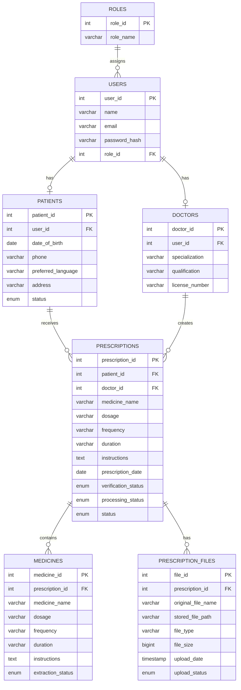

# Doctor Prescription Reminder - ER Diagram

## Sprint 2 Updated Database Design

## Sprint 2 Changes

- Added MEDICINES to store extracted medicine details.
- Added PRESCRIPTION_FILES to store uploaded prescription file metadata.
- Added processing_status to PRESCRIPTIONS.
- Established one-to-many relationships between PRESCRIPTIONS and both new entities.
