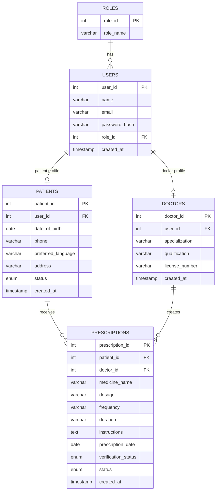

# Doctor Prescription Reminder System
## Entity Relationship Diagram (ER Diagram)

## Relationship Explanation

1. ROLES and USERS:
   One role can be assigned to many users.

2. USERS and PATIENTS:
   A user can have one patient profile.

3. USERS and DOCTORS:
   A user can have one doctor profile.

4. PATIENTS and PRESCRIPTIONS:
   One patient can receive multiple prescriptions.

5. DOCTORS and PRESCRIPTIONS:
   One doctor can create multiple prescriptions.

## Primary Keys

- roles: role_id
- users: user_id
- patients: patient_id
- doctors: doctor_id
- prescriptions: prescription_id

## Foreign Keys

- users.role_id references roles.role_id
- patients.user_id references users.user_id
- doctors.user_id references users.user_id
- prescriptions.patient_id references patients.patient_id
- prescriptions.doctor_id references doctors.doctor_id
